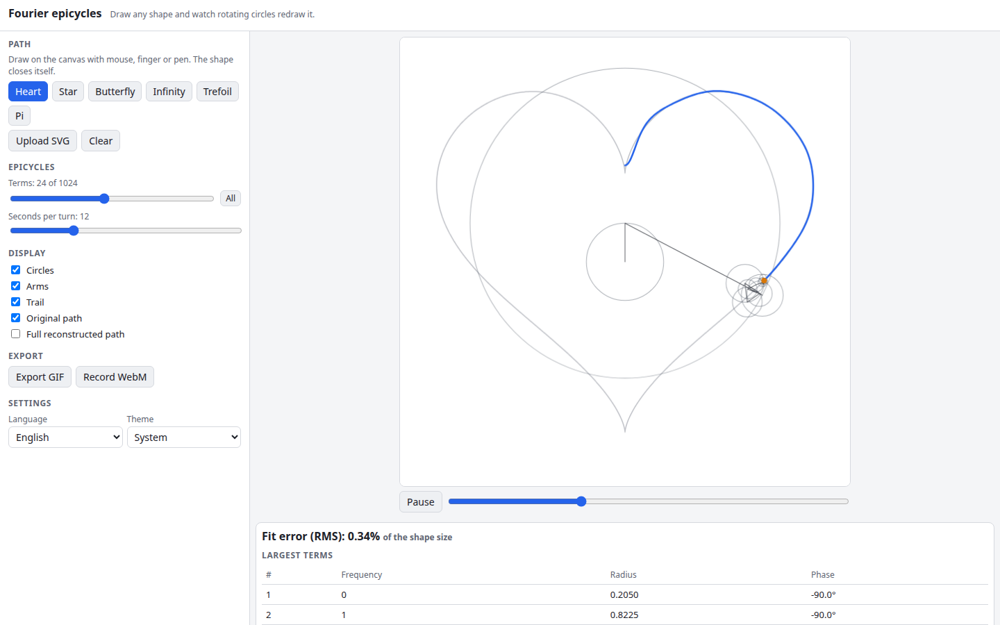

# Fourier Epicycles

Draw any shape, or upload an SVG, and watch a chain of rotating circles redraw it. The path is turned into a discrete Fourier series: every term is one circle whose radius and starting angle come from the transform and whose speed is its frequency. Choose how many circles to use, see how the picture sharpens as you add more, and export the animation as a GIF or video.

**Try it: [hermes98761234.github.io/fourier-epicycles](https://hermes98761234.github.io/fourier-epicycles/)**

[](https://github.com/hermes98761234/fourier-epicycles/actions/workflows/deploy.yml)



## Features

- **Draw with mouse, finger or pen.** The stroke is closed automatically and animated as soon as you lift.
- **Upload an SVG.** Paths, circles, rects, polygons and lines are sampled (transforms applied) and chained into one closed curve. Scripts in the file are stripped.
- **Presets:** heart, star, butterfly curve, lemniscate, trefoil and the letter pi. The star and pi have corners, which show the Gibbs-style ringing nicely.
- **1 to 1024 terms** on a logarithmic slider, with the fit error (RMS, as a share of the shape size) and a table of the largest terms.
- **Controls:** circles, arms, trail, original path and the full reconstructed path can be toggled; play, pause and scrub; 2 to 40 seconds per turn.
- **Export a GIF** (frame-accurate, adaptive palette, one full turn) or **record a WebM/MP4** video where the browser supports MediaRecorder.
- **English and Ukrainian, light, dark or system theme.** Settings and your last drawing are kept in the browser. No backend, no tracking.

## How it works

The path is resampled into N = 1024 points equally spaced by arc length and normalised to fit [-1, 1]. Each point is a complex number z_n = x + iy. The DFT gives coefficients

    c_k = (1/N) * sum_n z_n * e^(-2*pi*i*k*n/N)

and the curve is rebuilt as z(t) = sum_k c_k * e^(2*pi*i*k*t) for t in [0, 1). Terms are sorted by amplitude |c_k| (the constant term k = 0, the centre, comes first), so using M terms keeps the M biggest circles, which is the best M-term approximation in the least-squares sense. By Parseval the RMS error at the samples is the square root of the omitted energy, which is the number shown in the app.

GIFs are written by a small built-in encoder (median-cut palette, GIF LZW); nothing is uploaded anywhere.

## Quick start

You need [Node.js](https://nodejs.org/) 22.

```bash
git clone https://github.com/hermes98761234/fourier-epicycles.git
cd fourier-epicycles
npm install
npm run dev       # http://localhost:5173
npm test          # DFT, resampling, GIF/LZW, palette and settings tests
npm run build     # static site in dist/
```

## License

MIT
